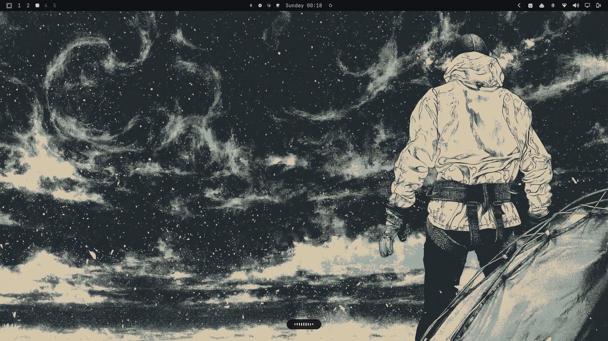

# voxtype-pill

A minimal recording indicator for [voxtype](https://voxtype.io), in the spirit of
Wispr Flow: a small dark pill near the bottom of the screen with nine thin bars
that move with your voice. No icon, no border, no level meter.




- **Recording:** the bars rise and fall with your mic level, taller in the middle.
- **Transcribing:** the bars ripple gently until the text is typed.
- **Idle:** the pill fades away.

It is a voxtype Quickshell *style package*, so it only changes how the popup
looks. Recording, transcription and hotkeys are untouched.

## Requirements

- voxtype 0.7.5 or newer, with the Quickshell OSD frontend (`voxtype-osd-quickshell`).
  On Arch and Omarchy this ships in the `voxtype-bin` AUR package.
- Quickshell (`qs`), which Omarchy 4 already includes.

## Install

```bash
git clone https://github.com/Nikshay1/voxtype-pill.git
mkdir -p ~/.config/voxtype/osd
cp -r voxtype-pill/pill ~/.config/voxtype/osd/pill
```

Add this to `~/.config/voxtype/config.toml` (replace any existing `[osd]` section):

```toml
[osd]
frontend = "quickshell"
style = "/home/YOUR_USER/.config/voxtype/osd/pill"
```

The style path must be absolute. Then restart voxtype:

```bash
systemctl --user restart voxtype
```

Hold your dictation key and the pill appears. If the QML fails to load, voxtype
falls back to its built-in card, so you never lose the indicator.

## Tweaking

Everything lives in `pill/Pill.qml`:

| What | Where |
|---|---|
| Pill size | `width: 112`, `height: 34` on the `pill` rectangle |
| Distance from the bottom | `y: root.height - height - 36` |
| Colours | `color` and `border.color` on the pill, `color` on the bars |
| Number of bars | `barCount` and the matching `envelope` list |
| Sensitivity | the `* 6.0` in the `target` line of the `Timer` (higher = jumpier) |
| Maximum bar height | the `* 22` in the bar `height` |

## License

MIT
